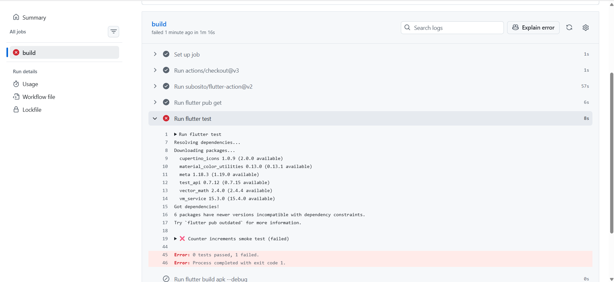
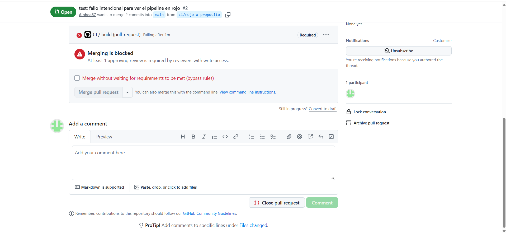

# Respuestas del Deber 4 — CI/CD y Automatización

## Pregunta 1: Explicación de ci.yml

### Código de `ci.yml`

```yaml
name: CI

on:
  push:
    branches: [ main ]
  pull_request:
    branches: [ main ]

jobs:
  build:
    runs-on: ubuntu-latest
    steps:
      - uses: actions/checkout@v4
      - uses: subosito/flutter-action@v2
        with:
          flutter-version: '3.x'
          channel: 'stable'
      - run: flutter pub get
      - run: flutter test
      - run: flutter build apk --debug

  entrega:
    needs: build
    if: github.ref == 'refs/heads/main' && github.event_name == 'push'
    runs-on: ubuntu-latest
    steps:
      - uses: actions/checkout@v4
      - uses: subosito/flutter-action@v2
        with:
          flutter-version: '3.x'
          channel: 'stable'
      - run: flutter pub get
      - run: flutter build apk --debug
      - uses: actions/upload-artifact@v4
        with:
          name: apk-debug
          path: build/app/outputs/flutter-apk/app-debug.apk
```

### Explicación de tareas:
* **`analyze` (`flutter analyze`):** Examina el código estático en busca de errores de sintaxis, malas prácticas y advertencias de linter sin ejecutar la app.
* **`test` (`flutter test`):** Ejecuta la suite de pruebas unitarias y de integración para confirmar que la lógica de negocio funciona como se espera.
* **`build` (`flutter build apk`):** Compila el proyecto Flutter y genera el archivo ejecutable e instalable (APK) para Android.

---

## Pregunta 2: Fallo Intencional (Parte 3)



* **Línea del log que indicó la falla:** La prueba unitaria falló indicando una discrepancia entre el valor esperado y el obtenido:  
  `Expected: <10.0> Actual: <12.0>` (o el mensaje de error correspondiente a la aserción de prueba fallida en `flutter test`).

---

## Pregunta 3: Diferencias en CI/CD y Elección de Implementación

* **Continuous Integration (CI):** Práctica de integrar y validar automáticamente el código con pruebas y compilación en cada cambio o Pull Request.
* **Continuous Delivery (CD):** Automatiza la preparación y generación del paquete final (como un APK), dejando el archivo listo para que un humano decida cuándo publicarlo.
* **Continuous Deployment:** Automatiza la publicación directa a producción (Google Play Store, usuarios finales) sin intervención humana inmediata.

### Implementación realizada:
Implementamos **Continuous Delivery (CD)**. Generamos el instalable APK automáticamente como un *artifact* descargable en GitHub Actions, pero no lo enviamos directamente a producción o tiendas públicas.

---

## Pregunta 4: Protección de la Rama Main




* **¿Qué problema evita?:** Evita que código defectuoso o con pruebas fallidas (*en rojo*) se integre directamente en la rama principal (`main`), asegurando que solo se fusione software verificado e íntegro.

---

## Pregunta 5: Revisión Crítica de Sugerencias del Agente (Parte 5)

### Sugerencias del agente:
1. **Fijar Hashes SHA:** Anclar acciones como `actions/checkout` a un commit hash completo en lugar de versiones flotantes (`@v3` / `@v4`).
2. **Versiones estrictas:** Cambiar `'3.x'` y `ubuntu-latest` por versiones fijas para evitar fallos si GitHub o Flutter actualizan sus bases.
3. **Optimizar entrega:** Usar `upload-artifact` en el primer job y `download-artifact` en `entrega` en lugar de recompilar desde cero.

### Decisiones adoptadas:
* **Aceptadas:** La actualización a `actions/upload-artifact@v4` (para corregir la deprecación de `@v3`) y la comprensión de que usar versiones fijas mejora la reproducibilidad.
* **Rechazadas en la práctica:** No fijamos los hashes SHA de 40 caracteres para mantener la legibilidad educativa del archivo `.yml`, aunque reconocemos que es la mejor práctica de seguridad corporativa.

---

## Pregunta 6: Garantías del CI Verde y Errores No Detectados

* **¿Qué garantiza un CI en verde?:** Garantiza únicamente que el código compila, no rompe la sintaxis y pasa las pruebas que han sido escritas explícitamente.
* **Errores no detectados:** No detecta fallos de usabilidad/interfaz (UX), problemas de diseño visual, lógica no cubierta por pruebas o errores en requerimientos del cliente.
* **Ejemplo:** Si un botón calcula mal una propina pero no existe una prueba unitaria que valide esa función específica, el CI pasará en verde aunque la aplicación tenga un fallo funcional.

---

## Pregunta 7: Detección del Pipeline No Observada

* **Lo que detectó el pipeline:** El pipeline detectó inmediatamente que la versión `actions/upload-artifact@v3` estaba deprecada y bloqueaba el job de entrega por políticas del runner de GitHub Actions, además de evidenciar los fallos automáticos en las pruebas que en desarrollo local no eran evidentes a simple vista.